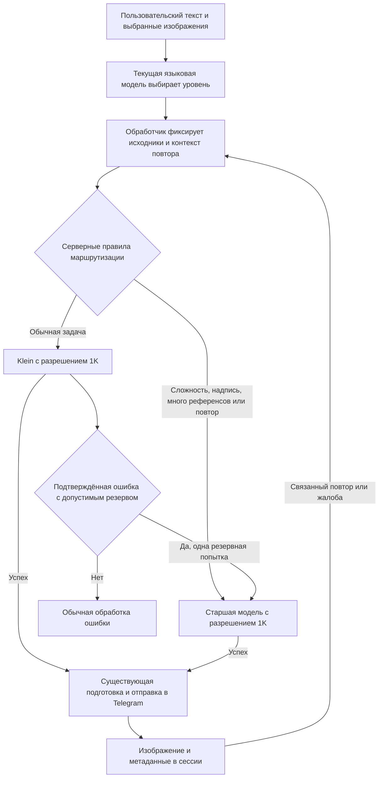

# План оптимизации стоимости изображений: FLUX 3 Image Klein + FLUX 3 Image

## 1. Зафиксированные требования

Реализовать согласованный гибрид автоматического выбора модели, серверных эвристик и ограничения разрешения. Интерфейс Telegram не менять: без кнопок, новых команд, обязательного выбора модели и показа промежуточных черновиков.

- Основная модель для обычных запросов — FLUX 3 Image Klein; старшая FLUX 3 Image — для сложных задач, защитных правил и повторов после неудачного результата.
- В оба инструмента изображений добавить необязательный параметр [`quality`](core/tool_registry.py:32) с двумя значениями: стандартный уровень и профессиональный уровень. Точные значения перечисления — [`standard`](core/tool_registry.py:32) и [`pro`](core/tool_registry.py:32).
- Сервер обязательно повышает уровень при наличии парных кавычек/маркеров надписи либо при использовании более двух референсов. Запрос старшего уровня нельзя понизить автоматически.
- В целевой конфигурации явно задавать разрешение 1K для обеих моделей и обеих операций.
- При повторе или жалобе на результат Klein следующий связанный запуск выполнять старшей моделью. Обычная новая задача не должна навсегда наследовать повышенный уровень.
- Сохранить существующую нумерацию изображений, выбор референсов, пропорции, индикацию ожидания и добавление результата в сессию.
- Не выполнять дополнительную генерацию или отдельный запрос к языковой модели только ради выбора маршрута.

**Границы обещаний:** доля замен около 75%, ускорение и отсутствие видимого ухудшения — гипотезы для проверки, а не подтверждённые характеристики. При обнаружении регрессий отключать проблемный маршрут, а не скрывать снижение качества.

Это контрольный план реализованной программной части и оставшейся операторской проверки. Этапы 1–7 покрыты кодом и офлайн-тестами; статусы ниже отражают финальную ревизию. Детерминированные фикстуры проверяют маршрутизацию и передачу параметров, но не качество изображений, полученных от живого API. В рамках этой ревизии платные сетевые вызовы не выполняются; доступность провайдера, фактическое качество, цены и включение эксперимента остаются отдельными операторскими gates.

## 2. Исходное состояние и обязательные уточнения

| Участок | Текущее поведение | Следствие для реализации |
| --- | --- | --- |
| [`config.yaml`](config.yaml:58), [`MediaSettings`](core/config.py:187) | Генерация и редактирование используют только старшую модель | Сохранить существующие поля как настройки старшего маршрута, добавить настройки Klein |
| [`ImageGenerationOptions`](core/common_types.py:66), [`ImageEditOptions`](core/common_types.py:80) | Есть параметры пропорций, разрешения и количества, но нет модели на конкретный вызов | Добавить необязательный выбор модели без мутации глобальных настроек |
| [`generate()`](utils/openrouter_images.py:76), [`edit()`](utils/openrouter_images.py:98) | Модель читается непосредственно из настроек | Использовать модель из опций, если она задана |
| [`OpenRouterService`](utils/openrouter_client.py:159) | Есть нормализация ошибок, нет управляемого переключения моделей | Резервный вызов организовать здесь, а не одновременно в нескольких слоях |
| [`TOOLS_SCHEMA`](core/tool_registry.py:27) | Инструменты принимают инструкцию, пропорции и номера референсов | Расширить схему без изменения имён инструментов |
| [`build_image_dict_from_image()`](core/tool_helpers.py:153) | Модель и стоимость результата не переносятся в сессию | Сохранить ограниченный набор метаданных для повторов и диагностики |
| [`append_user_image_to_session()`](core/state_and_commands.py:78) | Добавление изображения атомарное; сессия находится в памяти процесса | Не вводить новую БД, не считать сессию долговременным финансовым журналом |
| [`get_bot_reply()`](main.py:79) | Прикрепляются последние доступные изображения с исходными номерами | Добавить только внутреннюю сводку происхождения, не менять пользовательскую нумерацию |
| [`prepare_image_for_telegram()`](core/tool_helpers.py:61) | Изображение уменьшается до 1280 пикселей по длинной стороне и переводится в JPEG | Сравнивать качество именно после существующей подготовки для Telegram |

Уточнения к исходной концепции:

1. Документы обеих моделей перечисляют одинаковые основные поля Images API: [`docs/flux3.image.md`](docs/flux3.image.md:92), [`docs/flux3.image.klein.md`](docs/flux3.image.klein.md:98). Это не гарантирует идентичную поддержку каждым провайдером и одинаковое качество.
2. Поле [`seed`](core/common_types.py:75) упомянуто в документации Chat Completions, но отсутствует в перечне полей Images API обеих моделей. Не переносить эту возможность между API без подтверждения.
3. Пример стоимости 0.04 USD в документации — пример ответа, не тариф. Реальные цены, скорость и стоимость входных референсов нужно измерить.
4. Уровень 1K не означает гарантированные размеры 1024 × 1024 для всех пропорций. Размеры определяются провайдером. Уменьшение результата до 1280 пикселей само по себе не доказывает безвредность снижения разрешения генерации.
5. В текущем режиме редактирования по умолчанию используются все изображения сессии. После накопления трёх и более референсов серверное правило будет часто выбирать старшую модель; это ограничивает возможную экономию.
6. Klein недоступна для EU in-region routing: [`docs/flux3.image.klein.md`](docs/flux3.image.klein.md:8). Если такое ограничение потребуется, нельзя обходить его переключением региона; старшая модель допустима только при подтверждённой доступности в том же разрешённом регионе.
7. Одинаковое случайное начальное значение у разных моделей не обеспечивает одинаковую композицию. Переход на старшую модель — не гарантированный апскейл и не обещание попиксельного сохранения результата.

## 3. Целевая архитектура и ответственность слоёв

- Языковая модель оценивает смысл задачи в уже существующем вызове и выбирает подсказку уровня.
- Новый чистый модуль [`core/image_routing.py`](core/image_routing.py) принимает признаки запроса и возвращает решение. Он не обращается к сети, Telegram и хранилищу.
- Обработчики [`handle_generate_image()`](core/tool_handlers/media.py:147) и [`handle_generate_image_from_image()`](core/tool_handlers/media.py:230) готовят контекст, сохраняют UX и управляют доставкой.
- [`OpenRouterService`](utils/openrouter_client.py:159) выполняет ограниченную последовательность попыток и нормализует ошибки. Генерация видео не получает новую логику повторов.
- Адаптер [`utils/openrouter_images.py`](utils/openrouter_images.py) выполняет ровно одну попытку на обращение к адаптеру и формирует только разрешённые поля API.

## 4. Этап 0. Подтвердить контракт и снять исходные показатели

**Результат:** известны поддерживаемые параметры, фактическая цена и исходные показатели качества/задержки. Платные проверки выполняются отдельно и только после подтверждения бюджета оператором.

- [x] Проверить установленную версию OpenRouter SDK, способ управления его автоматическими повторами и доступные настройки запроса. В окружении установлен [`openrouter==1.1.29`](pixi.toml:34); локальная сигнатура `Images.generate_async()` подтверждает `retries`, а `retries=None` отключает SDK-повторы на image-пути.
- [ ] Через API обнаружения моделей и провайдеров из документации подтвердить доступность обоих идентификаторов, поддержку генерации/редактирования, разрешения 1K и нужных пропорций. В этой ревизии сетевое обнаружение не выполнялось; проверка не должна блокировать каждый пользовательский запрос.
- [x] Отдельно проверить контракт [`seed`](core/common_types.py:75) в Images API по локальной документации: поле не отправляется, а явно заданное неподдерживаемое значение отклоняется до SDK-вызова.
- [ ] Оператору проверить модельный идентификатор, реальные размеры и стоимость на минимальном разрешённом наборе платных генераций без референсов, с одним, двумя и тремя референсами.
- [ ] Оператору снять исходные показатели старшей модели с текущими настройками провайдера и отдельно сравнить старшую модель в 1K.
- [x] Зафиксировать и реализовать правила обработки счёта при ошибках: подтверждённый неуспешный 502 допускает одну попытку резерва с учётом документированного нулевого списания; таймаут, ошибка декодирования и прочие неоднозначные случаи не считаются бесплатными.

**Критерий готовности:** нет непроверенных предположений, влияющих на корректность запроса; автоматическое включение Klein не зависит от вымышленных тарифов или возможностей.

**Операторские проверки Этапа 0 остаются открытыми:** доступность моделей у выбранного провайдера и реальные размеры/цены требуют отдельного подтверждения; они не подменяются прохождением офлайн-тестов.

## 4.1 Ремарка
Python-команды проекта запускать через `pixi run`.

## 5. Этап 1. Конфигурация, типы и одиночный вызов адаптера

### 5.1. Настройки

Изменить [`config.yaml`](config.yaml:58), [`MediaSettings`](core/config.py:187), загрузчик [`Settings._media()`](core/config.py:480) и проверку [`Settings.validate()`](core/config.py:311).

| Поле | Целевое значение | Совместимость и назначение |
| --- | --- | --- |
| [`media.image_generation_model`](config.yaml:59) | Старшая FLUX 3 Image | Существующее поле сохраняется |
| [`media.image_edit_model`](config.yaml:60) | Старшая FLUX 3 Image | Существующее поле сохраняется |
| [`media.image_generation_fast_model`](core/config.py:187) | FLUX 3 Image Klein | Отдельная настройка младшего маршрута генерации |
| [`media.image_edit_fast_model`](core/config.py:187) | FLUX 3 Image Klein | Отдельная настройка младшего маршрута редактирования |
| [`media.image_routing_mode`](core/config.py:187) | Автоматический режим — [`auto`](core/config.py:187) | Значение при отсутствии поля в старом файле — только старшая модель, [`pro_only`](core/config.py:187) |
| [`media.image_default_resolution`](core/config.py:187) | 1K | При отсутствии поля сохранить прежнее поведение: разрешение выбирает провайдер |
| [`media.image_multi_reference_pro_threshold`](core/config.py:187) | 2 | Повышение происходит строго при превышении порога |
| [`media.image_fallback_enabled`](core/config.py:187) | Включено | Разрешает только безопасный технический резерв с Klein на старшую модель |

- [x] Проверять типы, непустые идентификаторы моделей, допустимый режим, разрешение и неотрицательный порог. Логические значения не принимать как целые числа.
- [x] Для обоих маршрутов FLUX ограничить количество результата одним изображением; не расширять поддержку пакетной генерации в этой задаче.
- [x] Не добавлять режим принудительной младшей модели, способный обойти запрос профессионального качества или защитные правила.
- [x] На старте логировать несекретную сводку режима и моделей. Одинаковые идентификаторы основного и резервного маршрута не должны приводить к повторному вызову той же модели.
- [x] Целевая рабочая конфигурация выставлена в `auto` + `1K`; фактический запуск/развёртывание эксперимента этой ревизией не выполнялся и остаётся gated оставшимися операторскими проверками Этапа 8.

### 5.2. Опции и адаптер

- [x] В [`ImageGenerationOptions`](core/common_types.py:66) и [`ImageEditOptions`](core/common_types.py:80) добавить необязательное поле [`model`](core/common_types.py:66) с передачей только по имени. Сохранить порядок существующих позиционных параметров и прежние значения по умолчанию.
- [x] Не добавлять параметр уровня качества в тело запроса OpenRouter. Подсказка маршрутизации существует только внутри приложения.
- [x] В [`generate()`](utils/openrouter_images.py:76) и [`edit()`](utils/openrouter_images.py:98) выбирать модель из опций либо использовать соответствующую существующую настройку старшей модели.
- [x] В [`_sdk_image_options()`](utils/openrouter_images.py:33) фильтровать поля по контракту и не отправлять необязательные незаданные значения; соответствующие ожидания закреплены тестами.
- [x] Сохранить ограничение десяти референсов, их порядок и передачу изображений через существующий механизм ссылок с данными.
- [x] В [`_decode_image_response()`](utils/openrouter_images.py:82) записывать фактически запрошенную модель и извлекать стоимость до проверки изображения.
- [x] При ошибке проверки ответа сохранять безопасные сведения о попытке и биллинге для сервисного слоя; изображение с некорректными байтами не передавать в Telegram.

**Критерий готовности:** разные конкурентные вызовы могут использовать разные модели без изменения глобальных настроек; старые прямые обращения без выбранной модели работают как раньше.

## 6. Этап 2. Метаданные происхождения и контекст пользовательского хода

### 6.1. Сохранение результата

Изменить [`build_image_dict_from_image()`](core/tool_helpers.py:153), [`generated_image_from_session_dict()`](core/tool_helpers.py:177) и при необходимости атомарное добавление в [`append_user_image_to_session()`](core/state_and_commands.py:78).

- [x] Для каждого нового результата сохранять отдельный ограниченный блок [`generation`](core/tool_helpers.py:153): идентификатор операции, фактическую модель и уровень, исходную инструкцию, тип операции, реальные номера использованных исходников, пропорции, разрешение и причину маршрута.
- [x] Добавить запрошенную модель, признак технического переключения, известную суммарную стоимость и признак неизвестного списания. Не заменять стоимость последнего вызова суммой всех попыток под тем же именем.
- [x] Исходная инструкция принадлежит конкретному изображению; повторы не восстанавливают её по последней записи общей истории.
- [x] Сохранять номера исходников после дедупликации и ограничения количества; подготовка выбора возвращает изображения и их реальные номера в сессии.
- [x] Не дублировать бинарные исходники в метаданных каждого результата. Перед повтором проверять доступность исходников по сохранённым номерам.
- [x] Сохранить чтение старых сессий без новых метаданных. Отсутствие модели не считается доказательством, что результат получен Klein.
- [x] Нумерацию не пересоздавать и не сдвигать; метаданные сохранять вместе с атомарным добавлением результата, общие словари менять под существующей блокировкой.

### 6.2. Передача исходного пользовательского текста

- [x] Из [`get_bot_reply()`](main.py:99) передавать исходное пользовательское сообщение отдельным необязательным аргументом [`user_text`](core/openai_api.py:293) в [`get_model_answer()`](core/openai_api.py:293).
- [x] Добавить соответствующее необязательное поле в [`ToolExecutionContext`](core/tool_registry.py:21), не ломая существующие конструкторы; во всех продолжениях одного хода использовать тот же исходный текст.
- [x] Учитывать обычный текст, подписи к изображениям и распознанную речь. Тесты подтверждают передачу подписи и распознанного текста в обработчик хода.
- [x] Не анализировать системный промпт и техническую сводку сессии как текст пользователя: роутер получает отдельные `user_text` и инструкцию инструмента.
- [x] Во внутреннем контексте языковой модели кратко указывать происхождение доступных изображений и последний успешный результат. Для связанного повтора включать исходную инструкцию и номера источников, без стоимости, секретов или бинарных дубликатов.

## 7. Этап 3. Чистый роутер, схема инструментов и автоматическое повышение

### 7.1. Решение маршрутизатора

Создать [`core/image_routing.py`](core/image_routing.py) и тесты [`tests/test_image_routing.py`](tests/test_image_routing.py).

- [x] Описать неизменяемый результат [`ImageRoutingDecision`](core/image_routing.py:17): выбранная модель, уровень, разрешение и короткий машинный код причины.
- [x] Реализовать [`resolve_image_route()`](core/image_routing.py:593), принимающую настройки, вид операции, подсказку уровня, инструкцию, исходный пользовательский текст, фактическое число референсов и цель повтора.
- [x] Предусмотреть явные причины выбора: режим только старшей модели, выбор языковой модели, маркеры текста, кавычки, много референсов, повтор после Klein, неизвестная подсказка, стандартный маршрут.
- [x] Не позволять аргументам инструмента задавать произвольный ID модели: сопоставление качества и модели выполняется по настройкам приложения.

**Приоритеты, сверху вниз:**

| Условие | Решение |
| --- | --- |
| Включён режим только старшей модели | Старшая модель |
| Передан профессиональный уровень либо пользователь явно просит максимальное качество | Старшая модель |
| Подсказка уровня задана, но имеет неверный тип или неизвестное значение | Старшая модель и диагностическая причина |
| Текущий запрос — связанный повтор/жалоба на результат Klein | Старшая модель; повышение относится только к текущему связанному запуску |
| Повтор относится к старшей модели или происхождение цели неизвестно | Не понижать качество: старшая модель |
| Фактически передаётся более двух референсов | Старшая модель, независимо от подсказки языковой модели |
| В пользовательском тексте или инструкции есть парные кавычки/маркеры надписи | Старшая модель |
| Подсказка стандартная или отсутствует, остальные правила не сработали | Klein |

- [x] Проверять парные непустые кавычки разных распространённых видов. Апостроф внутри английского слова и пустые/непарные кавычки не считаются маркером.
- [x] Искать маркеры надписей по границам слов и русским/английским формам; тестами исключены ложные срабатывания на словах про текстуру и дизайн.
- [x] Считать эти правила консервативными эвристиками, а не доказанным классификатором сложности; набор модульных тестов фиксирует их фактическое поведение.
- [x] Для сложной композиции, портретного сходства и сохранения деталей языковая модель может выбрать старший уровень без серверных маркеров; сценарии включены в офлайн-фикстуру Этапа 8.

### 7.2. Схема и инструкции языковой модели

- [x] Добавить необязательный [`quality`](core/tool_registry.py:51) в схемы [`generate_image`](core/tool_registry.py:41) и [`generate_image_from_image`](core/tool_registry.py:69); имена и обязательность инструкции сохранены.
- [x] В описании standard перечислены обычная генерация, стилизация и простые изменения; в pro — текст, сложность, точность, ограничения и исправление результата.
- [x] Согласовать рабочий системный промпт в [`config.yaml`](config.yaml:12) и резервный [`DEFAULT_SYSTEM_PROMPT`](core/config.py:24).
- [x] Для повтора предписаны профессиональный уровень и полная инструкция без выдуманных пожеланий пользователя.
- [x] Не раскрывать внутреннюю маршрутизацию без запроса и не обещать разрешение выше 1K.

### 7.3. Повтор и жалоба: поведение без новой кнопки

- [x] Определять повтор по текущему тексту и адресованному результату; давняя жалоба не влияет на новый запрос.
- [x] Использовать явно указанный номер; без номера для связанного повтора выбирать последний созданный результат, пропуская более позднюю загрузку.
- [x] Не подменять неоднозначные цели и сохранять pro-маршрут до разрешения неоднозначности.
- [x] Различать жалобу/повтор и обычную доработку; обычная правка не повышается только из-за прежней генерации.
- [x] Для повторной генерации с нуля восстановить полную инструкцию и уточнения без добавления неудачного изображения как референса.
- [x] Для повтора edit восстановить исходные референсы и инструкцию; при недоступных источниках не подменять их молча.
- [x] Для явной доработки результата разрешить использовать его как референс старшей модели без обещания апскейла.
- [x] Не сохранять постоянный pro-флаг после жалобы; новый несвязанный запрос снова маршрутизируется отдельно.
- [x] Старый результат не перезаписывать: успешный повтор добавляется в сессию как новая запись.

**Критерий готовности:** решение воспроизводимо в модульных тестах; языковая модель не может обойти повышение, а жалоба не меняет навсегда все последующие маршруты.

## 8. Этап 4. Ограниченный технический резерв в сервисе

Изменить только image-ветви [`OpenRouterService`](utils/openrouter_client.py:254). Общую обёртку [`_run()`](utils/openrouter_client.py:243) и операции видео не превращать в универсальный механизм повторов.

- [x] Первая попытка использует выбранную модель. Резерв разрешён только с Klein на соответствующую старшую модель, при включённой настройке и только один раз.
- [x] Для одного запуска ограничить число фактических попыток двумя; SDK-повторы на image-пути отключаются через подтверждённый `retries=None`.
- [x] Сохранить тот же текст, пропорции, разрешение, число результатов и снимок исходных референсов между попытками.
- [x] Использовать единый deadline на всю генерационную операцию на основе [`openrouter.timeout_ms`](config.yaml:59); таймауты доставки Telegram не меняются.
- [x] Перед резервом проверять оставшееся время; не запускать второй вызов после исчерпания лимита или отмены.
- [x] Не использовать младшую модель как резерв старшей, не строить каскад и не повторять одинаковый ID модели.

| Ситуация первой попытки | Поведение по умолчанию |
| --- | --- |
| Явный ответ 404 о недоступной модели/подходящем провайдере Klein | Одна попытка старшей модели при соблюдении тех же ограничений провайдера и региона |
| Явный ответ 502 о завершившейся неуспешной генерации | Одна попытка старшей модели; учитывать подтверждённые сведения о списании |
| 400, 413, 422 или неподдерживаемый параметр | Без переключения: исправлять запрос/контракт, не маскировать дефект резервом |
| 401, 402, 403, лимит расходов или запрет безопасности | Без переключения, обхода ограничений и изменения региона |
| 429 | По умолчанию без переключения: лимит может быть общим для ключа, а не только модели |
| Таймаут, разрыв соединения после отправки, отмена | Без автоматической повторной генерации: завершение и списание могут быть неизвестны |
| Изображение пришло, но не декодируется; ответ пустой/повреждённый | Без автоматического платного резерва; записать известное списание и диагностировать |
| Прочие 500/503 и неизвестная ошибка SDK | Без резерва, пока не подтверждено, что запрос завершён неуспешно и повтор безопасен |
| Сгенерированное изображение не удалось доставить в Telegram | Повтор генерации запрещён; обрабатывается ошибка доставки |

- [x] В [`_translate_exception()`](utils/openrouter_client.py:705) различать недостаток средств, авторизацию, лимиты, запрет контента и допустимые модельные ошибки; резерв опирается на структурированную причину.
- [x] [`map_generation_error()`](core/generation_error_mapper.py:116) выдаёт понятное сообщение о недостатке средств/лимите без раскрытия API-ключа.
- [x] При окончательной ошибке сохранять записи обеих попыток; при успехе возвращать фактическую модель и сведения о резерве.
- [x] Не менять провайдера/регион и не обходить расходы или ограничения при резерве.

## 9. Этап 5. Интеграция обработчиков и сохранение UX

- [x] В [`handle_generate_image()`](core/tool_handlers/media.py:839) валидировать запрос, подготовить контекст повтора, получить решение роутера и заполнить опции модели/разрешения.
- [x] В [`handle_generate_image_from_image()`](core/tool_handlers/media.py:917) сначала определить источники, выполнить дедупликацию/ограничение и только затем выбрать модель по фактическому числу референсов.
- [x] Для обычных правок использовать все изображения по умолчанию; связанный повтор восстанавливает источники адресованной операции.
- [x] Сохранить явные пропорции и пропорции единственного исходника; не добавлять белые поля и не менять композицию принудительно.
- [x] Создавать один статус на операцию и продолжать ту же анимацию при резерве.
- [x] Останавливать анимацию и удалять статус при успехе, исключении и отмене; один вызов инструмента доставляет не более одного изображения.
- [x] После доставки добавить ровно одну запись с происхождением; ошибка сессии не запускает генератор повторно и не пересылает изображение.
- [x] Внутренний [`ToolResult`](core/common_types.py:119) содержит безопасные сведения об операции, фактической модели/уровне и номере результата; фактическая Klein не маркируется как pro.
- [x] Ошибка возвращает признак запрета повторной платной генерации; ограничение проверяется на сервере.
- [x] Связать ID вызова с пользовательским ходом в [`get_model_answer()`](core/openai_api.py:301): повтор того же ID блокируется, а отдельные явно запрошенные изображения в том же ответе остаются допустимыми.

**Критерий готовности:** обычный чат визуально работает как раньше; техническая ошибка не размножает статусы, результаты и платные вызовы.

## 10. Этап 6. Наблюдаемость и расчёт экономии

- [x] Записывать структурированное событие каждой попытки с безопасными идентификаторами, моделью, маршрутом, разрешением, числом референсов, длительностью, статусом, кодом ошибки и стоимостью.
- [x] Фиксировать итог операции: доставку, число попыток, резерв/жалобу, время и фактический размер изображения.
- [x] Учитывать стоимость всех попыток, включая генерацию с последующей ошибкой; неизвестную стоимость не считать нулевой.
- [x] Сохранять совместимый смысл `metadata.cost` как стоимости результата; суммарную стоимость операции и полноту учёта хранить отдельно.
- [ ] Оператору проверить, что на текущем размещении операционные журналы/отчёты сохраняются достаточно долго и доступны для финансового анализа; в этом репозитории долговременное хранилище не вводилось.
- [x] Не логировать полные инструкции, изображения, бинарные данные, ссылки с токенами или секреты; тесты проверяют отсутствие этих данных в логах.
- [x] Агрегатор отчёта включает долю Klein, причины повышений, технические резервы, жалобы/повторы, median/p95 времени, стоимость доставленного результата и принятой задачи.
- [x] Учитывать дополнительный текстовый контекст в расчётной стоимости; отдельный платный оценщик качества в первой версии не добавлять.

Оценка до внедрения — только условная. Пусть K — цена первичной попытки Klein, P — цена старшей модели для сопоставимого запроса, f — ожидаемое число технических резервных вызовов на такой запрос, u — дополнительных вызовов старшей модели из-за жалобы. Тогда ориентир для младшего маршрута:

**Стоимость ≈ K + (f + u) × P + дополнительная стоимость текстового контекста.**

Маршрут экономичен, только если эта сумма ниже сопоставимого старшего маршрута. В рабочем отчёте использовать реальные списания, включая незавершённые задачи и неизвестные списания; у исходного старшего маршрута также учитывать его обычные повторы.

## 11. Этап 7. Автоматические проверки

Все проверки запускать через окружение проекта. Базовая команда: [`pixi run python -m pytest tests -q`](pixi.toml:9). Автотесты не должны обращаться к платным API; платную проверку выполнять отдельно с подтверждённым бюджетом.

| Набор | Обязательные сценарии |
| --- | --- |
| [`tests/test_config.py`](tests/test_config.py) | Старый файл настроек сохраняет старшую модель и прежнее разрешение; новые поля читаются; неверные типы, режимы, разрешения и количества отклоняются |
| [`tests/test_openrouter_images.py`](tests/test_openrouter_images.py) | Обе модели в обеих операциях; корректные метаданные фактической модели; отсутствие внутренних полей качества в API; политика неподтверждённого начального значения; стоимость при повреждённом ответе |
| [`tests/test_image_routing.py`](tests/test_image_routing.py) | Стандартный/профессиональный/отсутствующий/некорректный уровень; кавычки разных видов; апострофы; границы слов; ноль, один, два, три и десять референсов; все приоритеты; детерминированная фикстура качества маршрута и матрица трёх конфигураций |
| Новый [`tests/test_image_fallback.py`](tests/test_image_fallback.py) | Один разрешённый резерв после 404/502; запреты для остальных классов; одинаковые модели; точное сохранение исходников и разрешения; исчерпанный общий лимит; отмена; не более двух фактических попыток |
| [`tests/test_visual_sessions.py`](tests/test_visual_sessions.py) | Сохранение происхождения и источников, чтение старой сессии, неизменность номеров, конкурентные добавления, rollback без миграции, 1/2/3/10 референсов с 9:16/1:1/16:9/21:9, один результат и одно удаление статуса |
| [`tests/test_openai_tool_continuation.py`](tests/test_openai_tool_continuation.py) | Новый контекст доступен во всех кругах; повтор платной операции после ошибки не обходит ограничение; остальные инструменты и несколько разрешённых запросов работают |
| [`tests/test_openrouter_videos.py`](tests/test_openrouter_videos.py) | Логика видео и существующие опции не изменились |

Дополнительные обязательные последовательности:

- [x] Обычная генерация без подсказки → Klein в 1K → изображение сохраняет правильное происхождение.
- [x] Стандартная подсказка вместе с надписью/кавычками → старшая модель.
- [x] Два референса без иных причин остаются на стандартном маршруте; три → старшая модель. Используется фактический список выбранных источников.
- [x] Klein → связанная жалоба → старшая модель; новая простая задача после неё снова идёт в Klein.
- [x] Обычная просьба изменить цвет не повышается только из-за наличия предыдущей генерации.
- [x] Повтор генерации с нуля не превращается в редактирование; повтор редактирования восстанавливает оригинальные источники.
- [x] Явный выбор результата, более поздняя загрузка, старые метаданные и недоступные источники обрабатываются без произвольной подмены.
- [x] Ошибка доставки не вызывает повторную генерацию; стоимость логируется даже без записи результата в сессию.
- [x] После технического резерва метаданные отражают фактически доставленную модель.
- [x] Одновременные пользователи/операции не влияют на маршруты и подсказки качества друг друга.

## 12. Этап 8. Проверка качества, включение и откат

### Проверочный набор

Автоматическая фикстура ниже проверяет только детерминированные решения маршрутизатора и параметры запросов на заглушках. Она не генерирует изображения, не подтверждает визуальное качество или доступность провайдера и не заменяет операторскую проверку с подтверждённым бюджетом.

- [x] Создать фиксированную офлайн-фикстуру обычной сцены, иллюстрации, предмета, стилизации и простого изменения (ожидается `standard`/Klein/1K), а также точного русского и английского текста, портретного сходства, сложной композиции и сохранения деталей (ожидается `pro`).
- [x] Интеграционными тестами проверить редактирование с 1, 2, 3 и 10 выбранными референсами при 9:16, 1:1, 16:9 и 21:9; проверить модель, 1K, фактические источники и неизменённую пропорцию.
- [x] Офлайн-матрицей проверить конфигурации `pro_only` + `None`, `pro_only` + `1K` и `auto` + `1K`, включая ожидаемый маршрут/разрешение.
- [ ] Оператору получить изображения для одинакового набора запросов в трёх условиях: прежняя старшая модель/разрешение, старшая модель в 1K, гибрид в 1K. Не считать одинаковый seed гарантией одинакового результата.
- [ ] Оператору вслепую оценить инструкции, надписи, пропорции, сохранение исходников и артефакты по перемешанным результатам после существующей подготовки для Telegram.
- [ ] Фиксировать явную оценку набора и отдельно учитывать пользовательские повторы/замечания; отсутствие жалобы не считать доказательством принятия.

### Условия включения

- [x] Автотесты проходят без сетевых вызовов и списаний; их результаты не подменяют отдельное подтверждение живого API/провайдера.
- [ ] Оператору подтвердить контракты доступности моделей/провайдеров и проверить, что рабочие журналы содержат операции и стоимость.
- [ ] На живом проверочном наборе подтвердить отсутствие ухудшения; отдельно измерить влияние 1K на старшую модель и пересмотреть 1K, если регрессия вызвана именно разрешением.
- [ ] Подтвердить экономию по стоимости сопоставимых принятых задач с учётом повторов; отдельно показывать неизвестные списания.
- [ ] На рабочей выборке подтвердить, что median/p95 времени доставки и доля неуспешных запросов не хуже исходного маршрута; малую выборку не выдавать за статистическое равенство качества.
- [ ] После операторской проверки включить ограниченный эксперимент на разрешённой группе без изменения интерфейса и без фоновой двойной генерации.
- [ ] В рабочем эксперименте анализировать причины жалоб/повторов; расширять pro-правила или отключать Klein, если экономия переносит стоимость на пользовательские переделки.

### Откат

- [x] Офлайн-проверкой подтверждён маршрут отката: `image_routing_mode: pro_only` возвращает старшую модель.
- [x] Офлайн-проверкой подтверждён полный возврат разрешения к поведению провайдера: `image_default_resolution: null`; одного `pro_only` недостаточно, пока остаётся `1K`.
- [ ] Оператору при откате применить оба значения штатным способом конфигурации; переключение в развёрнутой среде этой ревизией не выполнялось.
- [x] Тестом подтверждено, что откат не требует миграции/очистки и старые записи без `generation` вместе с новыми записями полностью читаются и остаются неизменными.
- [x] Не добавлять переключатели, позволяющие обходить профессиональный уровень, безопасность, расходы или регион.

## 13. Порядок выполнения и границы первой версии

Исполнять последовательно: проверка контракта и исходных показателей → настройки/опции/адаптер → происхождение изображений и контекст хода → роутер/схемы/инструкции → ограниченный технический резерв → интеграция обработчиков/журналы → полный набор тестов → проверочный набор → ограниченное включение. Тесты добавлять вместе с соответствующими изменениями, не откладывая их полностью до конца.

Не включать в первую версию:

- кнопки улучшения, новые команды и ручной выбор модели;
- обязательную генерацию черновика перед каждой старшей генерацией;
- автоматическую платную оценку каждого изображения и бесконечную каскадную перегенерацию;
- параллельный запуск двух моделей с оплатой обоих результатов;
- выдачу оригиналов высокого разрешения, отдельное долговременное хранилище изображений и новый биллинг пользователей;
- смену региона ради доступности модели и обход лимитов провайдера.

**Итоговый критерий:** обычные задачи маршрутизируются в Klein с 1K, защитные правила и адресованные повторы — в старшую модель, интерфейс остаётся прежним, а экономия подтверждается измерениями без переноса затрат на дополнительные действия пользователя.
