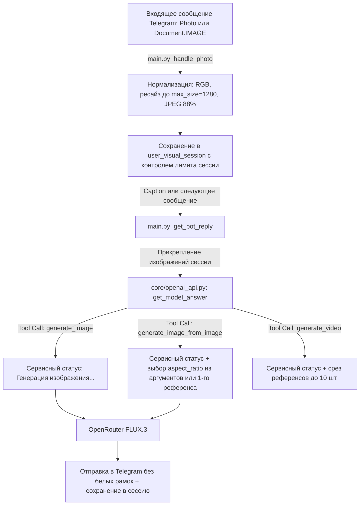

# Детальный план исправления работы бота с изображениями

## Архитектура целевого пайплайна обработки изображений

---
## Ремарка 0.
Во всех этапах команды по запуску python выполнять через pixi run

## Этап 1. Нормализация входящих изображений и поддержка документов (`filters.Document.IMAGE`)

**Цель:** Исключить переполнение памяти и ошибки `413 Payload Too Large` при отправке больших фотографий, а также позволить пользователям отправлять картинки без сжатия (как файлы/документы).

1. **Нормализация при загрузке ([`core/tool_helpers.py`](core/tool_helpers.py:36), [`main.py`](main.py:342))**:
   * Выделить в [`core/tool_helpers.py`](core/tool_helpers.py:36) универсальную функцию нормализации входных байтов изображения (конвертация `RGBA`/`P` в `RGB`, `img.thumbnail((max_size, max_size))` с `settings.media.telegram_image_max_size`, сохранение в `JPEG` с `settings.media.telegram_image_jpeg_quality`).
   * Применять эту нормализацию в [`handle_photo()`](main.py:356) перед сохранением `image_dict` в `user_visual_session`.
2. **Поддержка картинок-документов ([`main.py`](main.py:342), [`main.py`](main.py:440))**:
   * Расширить [`handle_photo()`](main.py:342), чтобы функция умела извлекать файл как из `update.message.photo[-1]`, так и из `update.message.document` (если MIME-тип начинается с `image/`).
   * Зарегистрировать обработчик в [`main()`](main.py:440) с фильтром `filters.PHOTO | filters.Document.IMAGE`.

---

## Этап 2. Корректная работа с пропорциями (`aspect_ratio`) и отказ от белых рамок

**Цель:** Убрать появление искусственных белых полос по краям отредактированных картинок и дать модели возможность управлять пропорциями при объединении нескольких изображений или по явному запросу пользователя.

1. **Полный список пропорций FLUX.3 ([`core/tool_handlers/media.py`](core/tool_handlers/media.py:34))**:
   * Обновить словарь `supported` в [`_sdk_aspect_ratio()`](core/tool_handlers/media.py:42), добавив все поддерживаемые моделью `black-forest-labs/flux-3-image` соотношения из [`docs/flux3.image.md`](docs/flux3.image.md:97):
     `21:9`, `2:1`, `16:9`, `3:2`, `7:5`, `4:3`, `5:4`, `1:1`, `4:5`, `3:4`, `5:7`, `2:3`, `9:16`, `1:2`, `9:21`.
2. **Гибкое управление `aspect_ratio` в инструментах ([`core/tool_registry.py`](core/tool_registry.py:27), [`core/tool_handlers/media.py`](core/tool_handlers/media.py:86))**:
   * Добавить опциональный параметр `aspect_ratio` в схему [`TOOLS_SCHEMA`](core/tool_registry.py:27) для `generate_image` и `generate_image_from_image`.
   * В [`handle_generate_image_from_image()`](core/tool_handlers/media.py:190):
     * Если модель явно передала `aspect_ratio` (например, пользователь попросил «сделай вертикальной 9:16» или «объедини в широкий баннер 16:9»), использовать его и **не добавлять** в промпт требование `preserve the original image aspect ratio`.
     * Если `aspect_ratio` не передан и редактируется одно изображение, использовать ближайший поддерживаемый `_sdk_aspect_ratio` исходника.
3. **Отказ от принудительного белого паддинга ([`core/tool_helpers.py`](core/tool_helpers.py:16), [`core/tool_handlers/media.py`](core/tool_handlers/media.py:225))**:
   * Не передавать `target_aspect_ratio` в [`send_image_to_telegram()`](core/tool_handlers/media.py:225) по умолчанию, чтобы [`prepare_image_for_telegram()`](core/tool_helpers.py:53) не дорисовывала белые поля (`_pad_image_to_aspect_ratio`) из-за минимальной разницы между пропорциями исходника и сеткой разрешения FLUX.3.

---

## Этап 3. Контроль размера `visual session` и лимитов референсов

**Цель:** Предотвратить переполнение контекста и ошибки API при длительной работе пользователя без команды `/reset`.

1. **Лимит референсов для видео ([`core/tool_handlers/media.py`](core/tool_handlers/media.py:284))**:
   * В [`handle_generate_video()`](core/tool_handlers/media.py:284) добавить ограничение `reference_images = reference_images[-10:]` по аналогии с [`handle_generate_image_from_image()`](core/tool_handlers/media.py:182).
2. **Ограничение количества картинок, передаваемых в Vision-запрос ([`main.py`](main.py:97), [`core/config.py`](core/config.py:187))**:
   * Добавить параметр `max_session_images: int = 10` в [`MediaSettings`](core/config.py:187) и [`config.yaml`](config.yaml:58).
   * При прикреплении картинок к Vision-запросу в [`get_bot_reply()`](main.py:99) или при хранении в сессии контролировать лимит, чтобы в один запрос не отправлялись десятки мегабайт base64-данных.

---

## Этап 4. Сервисная индикация (UX) при генерации и редактировании изображений

**Цель:** Обеспечить визуальную обратную связь пользователю на время генерации картинки (10–30 сек), аналогично генерации видео.

1. **Статусное сообщение с анимацией ([`core/tool_handlers/media.py`](core/tool_handlers/media.py:87))**:
   * В [`handle_generate_image()`](core/tool_handlers/media.py:87) и [`handle_generate_image_from_image()`](core/tool_handlers/media.py:150) перед вызовом `ctx.openrouter_service.generate` / `edit` отправлять сервисное сообщение через [`reply_service_message()`](core/state_and_commands.py:165) (`"Изображение генерируется, подождите"`) и запускать фоновую задачу [`animate_service_message()`](core/state_and_commands.py:171).
   * В блоке `finally` отменять задачу анимации и удалять статусное сообщение (или заменять его текстом ошибки при сбое), чтобы в чате оставалась только готовая картинка.

---

## Этап 5. Обновление и расширение автотестов

**Цель:** Гарантировать отсутствие регрессий и покрытие новых сценариев.

1. **Тесты в [`tests/test_visual_sessions.py`](tests/test_visual_sessions.py:1)**:
   * Проверить загрузку фото через `document` (`filters.Document.IMAGE`).
   * Проверить автоматическое сжатие больших изображений при загрузке в `handle_photo`.
   * Проверить работу `_sdk_aspect_ratio` на новых форматах (`4:5`, `5:4`, `2:1` и др.) и передачу явного `aspect_ratio` в `handle_generate_image` / `handle_generate_image_from_image`.
   * Проверить корректное закрытие анимации статусного сообщения при генерации изображения.
